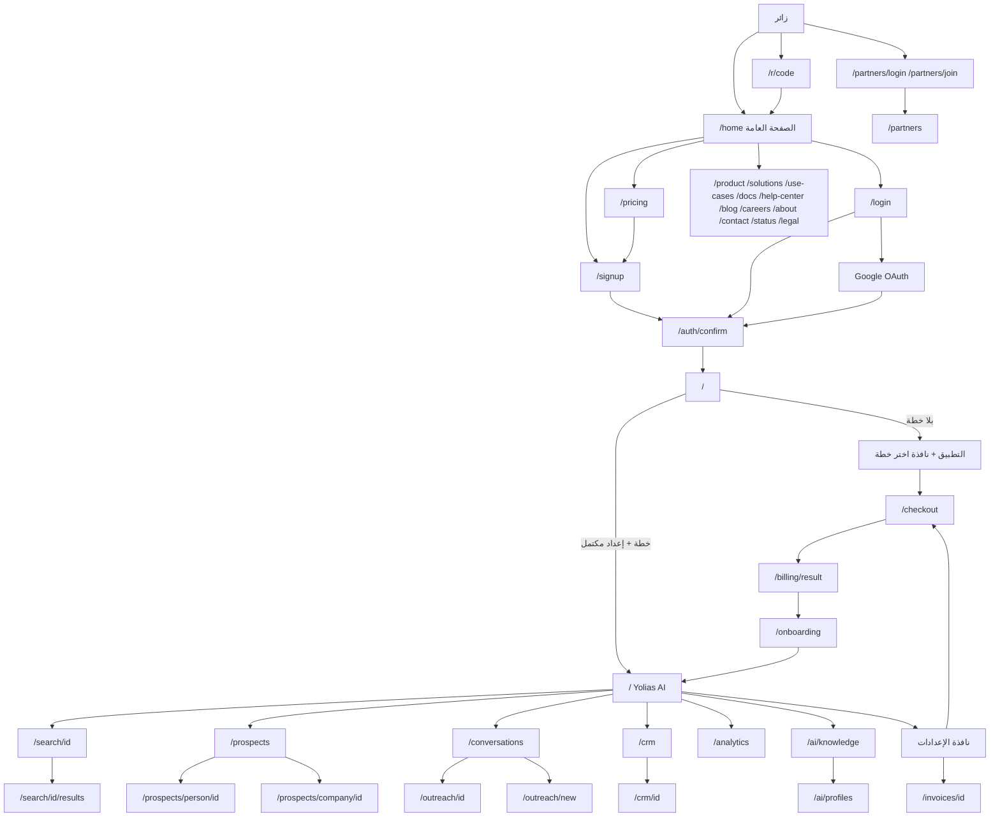
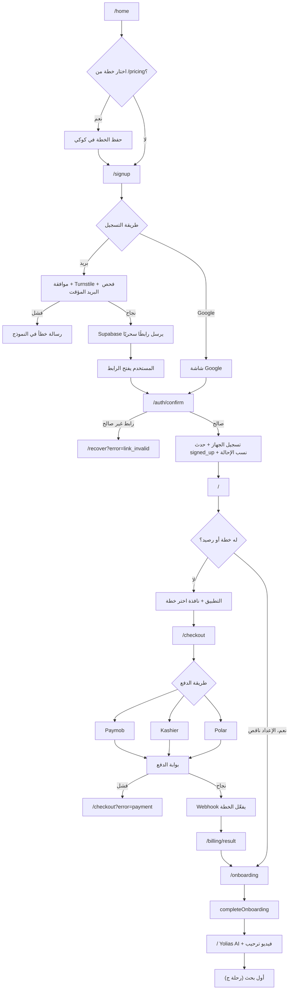
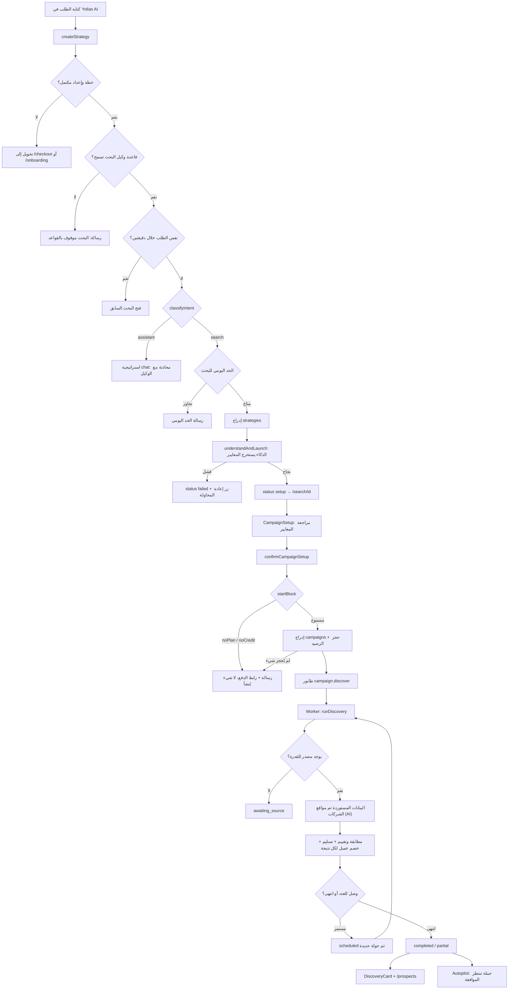
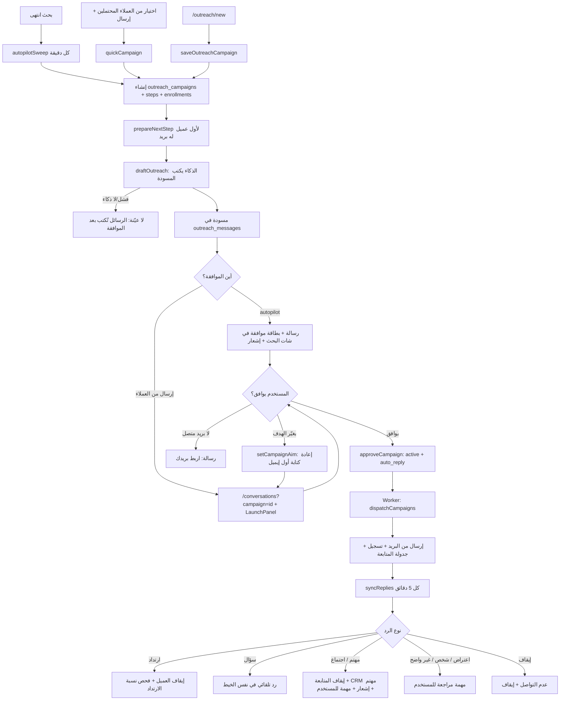
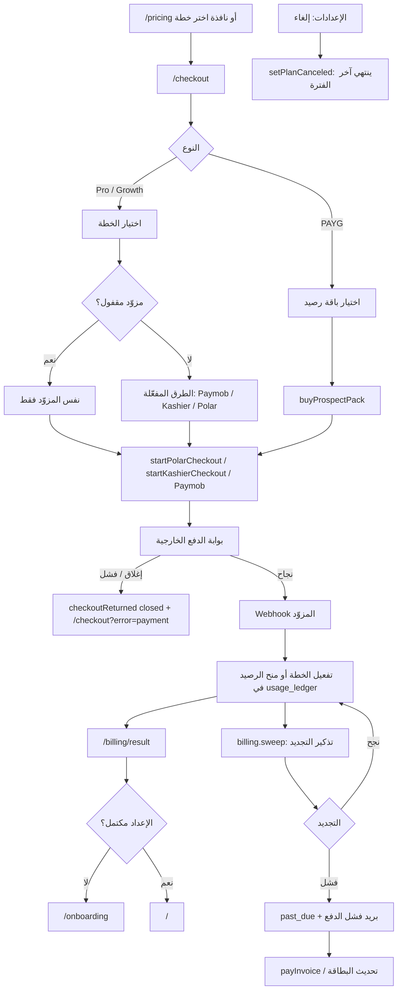
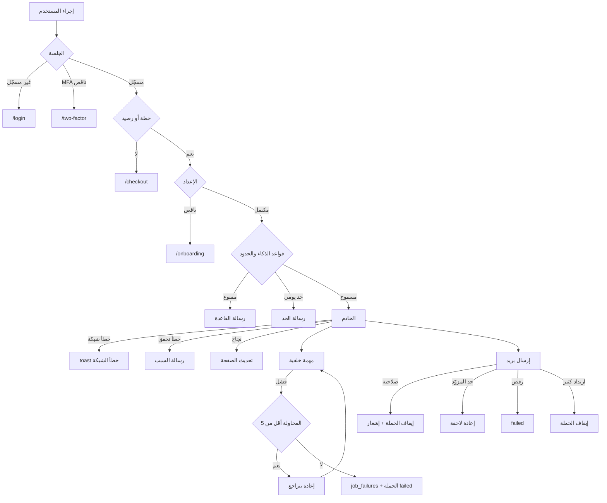
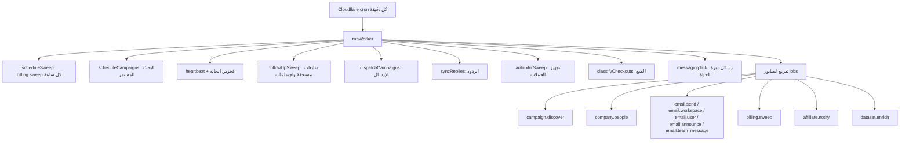

# مراجعة تدفقات المنتج ورحلات المستخدم في Yolias

تاريخ الفحص: 2026-10-21. الفرع `claude/amazing-lamport-haposg`، آخر commit مفحوص `c1dc77d`.
النطاق: تطبيق العملاء Yolias (المجلد `Yolias/`). لوحة Yolias Admin خارج النطاق إلا حين يعتمد عليها تدفق داخل Yolias (المفاتيح، مصادر البيانات، الرسائل التلقائية).

هذه وثيقة وصف فقط. لم يُعدَّل أي ملف من ملفات التطبيق أثناء إعدادها، ولم تُكتب أي بيانات في قاعدة الإنتاج (القراءات الوحيدة من الإنتاج: حالة `worker_state` وأعمدة جدول `outreach_campaigns`).

**اصطلاحات الأدلة**
- **[مؤكد]**: قرأت التنفيذ في الكود (المسار مذكور).
- **[استنتاج]**: مستنتج من الكود دون تشغيل المسار كاملًا.
- **[غير مؤكد]**: لم أستطع التحقق (يعتمد على إعدادات الإنتاج أو مفاتيح أو خدمات خارجية).

---

## 1. ملخص المنتج الحالي

Yolias منصة اكتساب عملاء B2B. المستخدم يكتب طلبًا بلغة طبيعية (مثل «شركات برمجيات في الرياض بها 10 إلى 200 موظف»)، فيحوّله Yolias AI إلى معايير بحث، يعرضها للمراجعة، ثم يبحث عن الشركات والأماكن المطابقة، ويحفظها في «العملاء المحتملون». من هناك يستطيع المستخدم إنشاء حملة بريد تُرسَل من بريده هو (Gmail أو IMAP/SMTP)، تُقرأ الردود وتُصنَّف في «المحادثات»، وتُنقل الصفقات إلى «إدارة العملاء» (CRM).

العناصر الأساسية [مؤكد]:
- **الدخول**: رابط سحري بالبريد أو Google، بلا كلمة مرور (`app/(auth)/actions.ts`).
- **الدفع**: رصيد «حسب الاستخدام» (PAYG) أو اشتراك شهري Pro / Growth، عبر Polar أو Kashier أو Paymob حسب ما تفعّله الإدارة (`app/checkout/page.tsx`، `lib/payments/`).
- **وحدة الاستهلاك الوحيدة**: «العميل المحتمل» (prospect). كل نتيجة تُسلَّم من بحث تخصم واحدًا (`lib/plans.ts`، `lib/discovery/pipeline.ts`).
- **البحث**: مصادر البيانات الموجودة في الكود ثلاثة فقط: البيانات المستوردة (`yolias_datasets`)، مواقع الشركات عبر الذكاء الاصطناعي (`yolias_web`)، والتحقق من البريد (`millionverifier`). **لا يوجد مصدر للبحث عن الأشخاص** (`lib/intel/adapters/index.ts`).
- **الذكاء الاصطناعي**: محوّل لثلاثة مزوّدين في الكود (Anthropic وOpenAI وGemini)، والمسار الفعلي يحدده إعداد محفوظ في الإدارة (`lib/ai/llm/index.ts`).
- **الخلفية**: مهمة كل دقيقة على Cloudflare (cron) تشغّل الطابور وإرسال الحملات وقراءة الردود والمتابعات والتجهيز التلقائي للحملات (`Yolias/wrangler.jsonc`، `lib/jobs/worker.ts`).

---

## 2. خريطة الصفحات والتنقل

### 2.1 حراسة المسارات (proxy)
الملف `Yolias/proxy.ts` يعمل على كل طلب [مؤكد]:
- `yolias.com` يُحوَّل إلى `www.yolias.com` (301).
- مسارات التطبيق المحمية: `/analytics`، `/campaigns`، `/prospects`، `/search`، `/checkout`، `/onboarding`، `/invoices`، `/billing`، `/outreach`، `/inbox`، `/crm`، `/ai`. الزائر غير المسجّل يُحوَّل إلى `/login`.
- ملاحظة [مؤكد]: `/conversations` **ليست** في قائمة `appPaths`، لكن الصفحة نفسها تستدعي `requireViewer()` التي تحوّل غير المسجّل إلى `/login` (`lib/session.ts:49`)، فالنتيجة واحدة.
- `/` لغير المسجّل يُعاد كتابته داخليًا إلى `/home` (الصفحة التسويقية)، وللمسجّل يعرض Yolias AI.
- `/checkout` لغير المسجّل يحوّل إلى `/signup`.
- المسجّل الذي يفتح `/login` أو `/signup` أو `/recover` يُحوَّل إلى `/`.
- إذا كان الحساب بخطوة تحقق ثانية (MFA) ولم تُدخل بعد: يحوّل إلى `/two-factor`.
- طلبات Server Actions لا تُحوَّل أبدًا (حتى لا تفشل باستجابة غير متوقعة).

### 2.2 حراسة الصفحات داخل التطبيق (`lib/session.ts`) [مؤكد]
| الدالة | ما تتطلبه | ما يحدث عند الفشل |
|---|---|---|
| `getSession()` | توكن صالح + `session_context()` | يرجع null |
| `requireUser()` | مستخدم مسجّل | `/two-factor` أو `/auth/signout` أو `/login` |
| `requireViewer()` | مستخدم مسجّل؛ وإن كان له خطة ولم يكمل الإعداد | `/onboarding` |
| `requireSession()` | خطة فعالة أو رصيد PAYG + إعداد مكتمل | `/checkout` (أو `/checkout?plan=…`) ثم `/onboarding` |

النتيجة: **صفحات التطبيق تُعرض للمستخدم بلا خطة** (requireViewer)، مع شريط ونافذة «اختر خطة» (`PlanGateModal`، `components/app/AppShell.tsx:315-342`)، **لكن كل إجراء** (بحث، حملة، CRM…) يستدعي `requireSession()` فيُحوَّل إلى الدفع [مؤكد].

### 2.3 الصفحات (53 صفحة)

**صفحات عامة (`app/(marketing)/`)** [مؤكد]: `/home` (الرئيسية)، `/pricing`، `/product`، `/solutions` و`/solutions/[slug]`، `/use-cases` و`/use-cases/[slug]`، `/docs` و`/docs/[slug]`، `/help-center` و`/help-center/[slug]`، `/blog` و`/blog/[slug]`، `/careers` و`/careers/[slug]`، `/about`، `/contact`، `/community`، `/affiliates` و`/affiliates/terms`، `/legal/[slug]`، `/status`. محتواها من `lib/content/*` ومن جدول `content_entries` (المدونة، الوظائف، المساعدة).

**الدخول (`app/(auth)/`)**: `/login`، `/signup`، `/recover`، `/two-factor`. ومسارات: `/auth/confirm` (تأكيد الرابط)، `/auth/signout`.

**التطبيق (`app/(app)/`)**: `/` (Yolias AI)، `/search/[id]` و`/search/[id]/results`، `/prospects` و`/prospects/person/[id]` و`/prospects/company/[id]`، `/conversations`، `/outreach`، `/outreach/new`، `/outreach/[id]`، `/inbox`، `/crm` و`/crm/[id]`، `/analytics`، `/ai/knowledge`، `/ai/profiles`.

**الدفع والحساب**: `/checkout`، `/checkout/pay/[id]`، `/billing/result`، `/invoices/[id]`، `/onboarding`.

**الشركاء**: `/partners`، `/partners/join`، `/partners/login`، `/affiliate` (يحوّل إلى `/partners`)، `/r/[code]` (رابط إحالة).

**أخرى**: `/unsubscribe/[token]`، `/support-widget/[key]/[...path]` (وكيل لودجت الدعم)، `/dev/emails` (معاينة قوالب البريد للتطوير).

### 2.4 قوائم التطبيق (`components/app/AppShell.tsx:30-46`) [مؤكد]
- القائمة الرئيسية: Yolias AI (`/`)، التحليلات (`/analytics`)، العملاء المحتملون (`/prospects`).
- قائمة العمل: المحادثات (`/conversations`، وتُعتبر نشطة أيضًا في `/outreach/*` و`/inbox`)، إدارة العملاء (`/crm`)، معرفة الشركة (`/ai/knowledge`).
- «عمليات البحث الأخيرة»: آخر الاستراتيجيات (`recentStrategies`).
- أسفل القائمة: المستخدم والخطة، وقائمة فيها الإعدادات والمساعدة والخروج.
- الإعدادات نافذة منبثقة بتبويبات: عام، الحساب، الإشعارات، الاستخدام، الفواتير، الفريق، التكاملات (`components/app/SettingsModal.tsx:26-34`).

---

## 3. رحلات المستخدم

### أ. رحلة المستخدم الجديد [مؤكد إلا ما يُذكر]

1. **الصفحة العامة** `/home` ثم `/pricing` أو `/signup` مباشرة. إن اختار خطة من `/pricing` تُحفظ في كوكي (`PLAN_COOKIE` لمدة 30 يومًا، `app/(auth)/actions.ts:26`).
2. **التسجيل** `/signup`: بريد + موافقة على الشروط وعمر 18+ + تحقق Turnstile + رفض البريد المؤقت (`sendMagicLink`, mode=signup). يُنشئ الحساب برابط سحري (`signInWithOtp` مع `shouldCreateUser: true`) ويُحفظ الاسم والشركة والخطة في بيانات المستخدم. البديل: «المتابعة بـ Google» (`signInWithGoogle`).
3. **تأكيد الرابط** `/auth/confirm`: يتحقق من `token_hash` أو `code`. يسجّل الجهاز ويرسل تنبيه «دخول جديد» عند جهاز غير معروف، ويسجّل حدث `signed_up`، وينسب الإحالة إن وُجد كوكي الشريك (`app/auth/confirm/route.ts`). ثم يحوّل إلى `/` (أو `/partners` لحسابات الشركاء).
4. **التطبيق بلا خطة**: يرى Yolias AI مع شريط ونافذة «اختر خطة». أي إجراء يحوّل إلى `/checkout`.
5. **الدفع** `/checkout`: يختار PAYG (باقة رصيد) أو Pro أو Growth، وطريقة الدفع الظاهرة حسب مفاتيح الإدارة (`payments_paymob`، `payments_kashier`، `payments_polar`). يُفتح سجل `checkout_sessions` عند عرض الصفحة لتتبع القمع.
6. **نتيجة الدفع** `/billing/result` ثم التفعيل عبر Webhook المزوّد (انظر 3.هـ).
7. **الإعداد الأول** `/onboarding` (يتطلب خطة، `app/onboarding/page.tsx:20`): الاسم، اسم الشركة، الموقع، المجال، ماذا تبيع، العميل المثالي، الأسواق (`completeOnboarding`). عضو الفريق (غير المالك) يرى نسخة أقصر.
8. **أول دخول للتطبيق**: فيديو ترحيبي إن كان مفعّلًا ولم يُشاهد (`welcome.show`).
9. **أول مهمة ناجحة**: كتابة طلب في Yolias AI، مراجعة المعايير والضغط «ابدأ»، ثم ظهور النتائج (رحلة ج).

### ب. رحلة المستخدم الحالي
1. `/login`: بريد فقط، الرابط السحري لا يُنشئ حسابًا (`shouldCreateUser: false`). إن لم يوجد حساب: رسالة «لا يوجد حساب» [مؤكد]. أو Google.
2. طلبات روابط كثيرة لنفس الحساب خلال ساعة: بريد أمان (`signInRequested`، `lib/email/events.ts`) [مؤكد].
3. إن كان مفعّلًا التحقق الثنائي: `/two-factor` لإدخال الرمز (`TwoFactorForm.tsx`) [مؤكد].
4. `/` Yolias AI، والتنقل عبر القائمة الجانبية (2.4). الإشعارات من أيقونة الجرس (`listNotifications` / `markRead`).
5. الاستعادة `/recover`: نفس الرابط السحري بوضع recover (لا يُنشئ حسابًا) [مؤكد].

### ج. رحلة البحث واكتشاف العملاء المحتملين

**الخطوات وما يحدث داخل النظام** [مؤكد ما لم يُذكر]:
1. **الكتابة** في `StrategyComposer` (`components/app/StrategyComposer.tsx`): نص حتى 4000 حرف، مرفقات (صور تُصغَّر قبل الإرسال)، واختيار ملف عميل.
2. **الإرسال** `createStrategy` (`app/(app)/actions.ts:26`):
   - `requireSession()` (خطة + إعداد).
   - قاعدة «وكيل البحث» في إعدادات الذكاء الاصطناعي (قد تمنع البحث).
   - منع التكرار: نفس الطلب خلال دقيقتين يفتح البحث السابق.
   - **تصنيف النية** `classifyIntent`: إن كان الطلب ليس بحثًا (ردود، حملات، تحليلات…) تُنشأ استراتيجية بحالة `chat` ويتحول إلى محادثة مع الوكيل. للتصنيف مهلة 12 ثانية ثم قواعد احتياطية (`lib/ai/intent.ts`).
   - **الحد اليومي** `takeDaily(..., "search")` حسب الخطة.
   - إدراج صف في `strategies` ثم `understandAndLaunch` (`lib/discovery/launch.ts:24`): الذكاء الاصطناعي يحوّل الطلب إلى ICP (معايير). عند الفشل: الاستراتيجية `failed` مع رمز الخطأ.
   - النجاح: الحالة `setup` ويُحوَّل المستخدم إلى `/search/[id]`.
3. **مراجعة المعايير** `CampaignSetup` (`components/app/CampaignSetup.tsx`): نوع البحث، العدد المطلوب، الدول، المدن، المجالات، الكلمات، المسميات، حجم الشركة، الاستثناءات. الضغط «ابدأ» يستدعي `confirmCampaignSetup` ثم `confirmSetup`:
   - `startBlock`: لا خطة يرجع `noPlan`، والرصيد صفر يرجع `noCredit`. تظهر رسالة مع رابط الدفع ولا يُنشأ شيء.
   - `startCampaign`: إدراج `campaigns` بحالة `queued` + **حجز الرصيد** فورًا (`reserve_usage`). إن لم يُحجز شيء تُحذف الحملة ويرجع `noCredit`.
   - طابور `campaign.discover`.
4. **التشغيل في الخلفية** `runDiscovery` (`lib/discovery/pipeline.ts:65`): الحالات `queued` ثم `discovering_companies` ثم … ثم `completed` أو `partial` أو `failed`. كل خطوة تُسجَّل في `campaign_events` وتظهر كنشاط في الواجهة.
   - البحث عن الشركات/الأماكن عبر طبقة الذكاء (`lib/intel`): البيانات المستوردة أولًا، ثم اكتشاف المواقع بالذكاء الاصطناعي.
   - إن لم يوجد مصدر للقدرة المطلوبة: الحالة `awaiting_source` ورسالة «لا يوجد مصدر متصل».
   - كل نتيجة تُسلَّم تُحسب «عميلًا محتملًا» من الرصيد.
   - **الأشخاص**: خطوة `discoverPeople` لا تجد مزوّدًا (لا يوجد محوّل `person.search`)، فبحث «الأشخاص» لا يُرجع أشخاصًا من مصدر خارجي [مؤكد من `lib/intel/adapters/index.ts`].
   - البحث المستمر: `continuous` مع `run_every_hours` و`deadline`، والحالة `scheduled` بين الجولات (`scheduleCampaigns` في `lib/jobs/worker.ts`).
5. **النتائج**: بطاقة الاكتشاف في `/search/[id]` (`DiscoveryCard`) وصفحة `/search/[id]/results`، ثم «العملاء المحتملون» `/prospects`.
6. **الإجراءات على النتائج** (`app/(app)/prospects/actions.ts`): كشف بيانات التواصل (`revealContacts`، بلا خصم رصيد)، العثور على صنّاع القرار (`findDecisionMakersAction`، **يظهر فقط عند وجود مصدر أشخاص**)، الإزالة، الحفظ/الإلغاء، إضافة إلى CRM، إضافة إلى حملة، «إرسال» كحملة جديدة، تصدير CSV، استيراد CSV (`importContacts`).
7. **التجهيز التلقائي للحملة** (D-253): بعد انتهاء البحث تُجهَّز حملة بريد تلقائيًا وتنتظر موافقة واحدة (رحلة د).

### د. رحلة إعداد رسائل التواصل

**ثلاثة مداخل** [مؤكد]:
1. **التجهيز التلقائي بعد البحث** (`lib/outreach/autopilot.ts`): كل دقيقة يبحث العامل عن بحث انتهى (بعد 2026-10-21 17:00 UTC) ووجد نتائج ولا حملة له. ينشئ حملة (هدف ورابط ونبرة آخر حملة في الحساب)، يضيف ناس البحث كعملاء (`searchTargets`: الأشخاص، والشركات التي ليس لها شخص في القائمة)، يكتب أول إيميل واحد فقط، **لا يرسل شيئًا**، ثم يضع رسالة في شات البحث مع زر «موافقة» (صلاحية 7 أيام) وإشعارًا. البحث المستمر: بعد كل جولة جديدة ينضم الجدد للحملة الموافَق عليها.
2. **من العملاء المحتملين** «إرسال» (`SendDialog` في `components/app/ProspectTable.tsx`): اسم الحملة + الهدف (اجتماعات / تعريف / بيع مباشر) + الرابط (للتعريف والبيع فقط) ثم `sendSelectionAsCampaign` ثم `quickCampaign`: إنشاء الحملة وخطوتين (أول رسالة + متابعة بعد 3 أيام)، ضم المختارين، كتابة أول إيميل، والانتقال إلى `/conversations?campaign=…`.
3. **من صفحة الحملات** «حملة جديدة» `/outreach/new` (`CampaignForm`): الاسم، الهدف النصي، الوصف، اللغة، النبرة، ملف العميل، العرض، الخطوات (حتى حد الرسائل لكل عميل)، ويمكن البدء من بحث سابق.

**كتابة الرسالة** (`prepareNextStep` في `lib/outreach/sequence.ts` ثم `draftOutreach` في `lib/outreach/index.ts`) [مؤكد]: يجمع بيانات العميل، معرفة الشركة، العرض، ملف العميل، هدف الحملة (`aimGuidance` في `lib/outreach/aim.ts`)، تعليمات الخطوة، وتاريخ المحادثة للمتابعات. يُحفظ كمسودة في `outreach_messages`. يحترم قواعد «عدم التواصل» والقائمة السوداء ومهلة إعادة التواصل (`enrollLeads`).

**الموافقة** (`LaunchPanel` في المحادثات أو صفحة الحملة، أو بطاقة الموافقة في الشات) ثم `approveCampaign` (`lib/outreach/execute.ts:36`): يتطلب بريدًا متصلًا للمستخدم نفسه، يسجّل من وافق ومتى، الرد التلقائي مفعّل افتراضيًا.

**ما ينفّذه Yolias وما ينفّذه المستخدم** [مؤكد]:
| Yolias (تلقائي بعد الموافقة، على الخادم) | المستخدم |
|---|---|
| كتابة أول رسالة والمتابعات | يختار الهدف والرابط ويوافق مرة لكل حملة |
| الإرسال من بريد المستخدم ضمن الحد اليومي (افتراضي 50) | يربط بريده (Gmail أو IMAP/SMTP) |
| إيقاف المتابعات عند الرد أو الارتداد | يستطيع التعديل أو الإرسال اليدوي أو الحذف لأي مسودة |
| قراءة الردود في الخيوط التي بدأها وتصنيفها | يرد بنفسه من المحادثات متى أراد |
| الرد التلقائي على **الأسئلة البسيطة** فقط | **يكمل مع المهتم أو طالب الاجتماع** ويرسل رابط الاجتماع بنفسه |
| نقل المهتم إلى CRM وإشعار + مهمة «كمّل انت» | يحرّك الصفقة في CRM |
| إيقاف الحملة عند 5% ارتداد بعد 20 رسالة | يستأنف بعد مراجعة العناوين |

### هـ. رحلة الاشتراك والدفع [مؤكد ما لم يُذكر]
- **الخطط** (`lib/plans.ts`): `free` (قديمة)، `pro` (50$ = 1,000 عميل/شهر)، `growth` (100$ = 2,000)، `scale` (لم تعد معروضة، الحالية تستمر). القيم الحية من قاعدة البيانات (`lib/plan-catalog.ts`).
- **PAYG**: باقات رصيد من جدول `prospect_packs` (100/400/1,000/2,000 بسعر 5 سنت للعميل)، بلا انتهاء، وتشترى عبر `buyProspectPack` (`app/checkout/actions.ts:109`). شراء رصيد مرة واحدة يفتح التطبيق (`canUseApp`).
- **التجربة المجانية**: الكود يدعمها مع Polar فقط (`trialOpen`)، والقرار D-246 «لا تجربة مجانية» [استنتاج: تُعرض فقط إن كانت مفعّلة في الإعدادات].
- **طرق الدفع**: Paymob (الافتراضي في `billingRoute`)، Kashier (تجديد من البطاقة المحفوظة)، Polar (دولي، اشتراك وبوابة عميل). تظهر كل طريقة فقط إن فعّلتها الإدارة (`payments_*`). مزوّد اشتراك قائم «مقفول» لا يتغير (`lockedProvider`).
- **مشترو مصر**: سطر بالجنيه في صفحة الدفع بسعر اليوم (`paysInEgp`، `usdToEgp`).
- **التفعيل**: Webhooks `app/api/webhook/polar/route.ts`، `app/api/payments/kashier/route.ts`، `app/api/payments/paymob/route.ts`، وصفحات العودة `…/return`. يُسجَّل في `payments`، `invoices`، `subscription_events`، `billing_webhook_events` [استنتاج من أسماء الجداول والملفات؛ لم أتتبع كل Webhook سطرًا بسطر].
- **التجديد والتذكير**: `billing.sweep` كل ساعة (`lib/billing`).
- **الإلغاء**: `setPlanCanceled` (إلغاء في نهاية الفترة) من الإعدادات.
- **الفواتير**: `/invoices/[id]`، والدفع لفاتورة مفتوحة `payInvoice` و`/checkout/pay/[id]`.
- **الاستخدام**: دفتر `usage_ledger` (منح، استهلاك، حجز)، والدوال `usage_summary`، `reserve_usage`، `usage_outstanding`. تبويب «الاستخدام» في الإعدادات (`refreshUsage`، `creditHistory`).
- **حالات الاشتراك**: `active`، `trialing`، `test`، `past_due` كلها تفتح التطبيق؛ `none` و`canceled` لا (إلا مع رصيد PAYG).

### و. رحلة إعدادات الحساب (`components/app/SettingsModal.tsx`) [مؤكد للأسماء، استنتاج لتفاصيل بعض الحقول]
| التبويب | المحتوى والإجراءات | الدوال |
|---|---|---|
| عام | السمة، حجم النص، اللغة، المنطقة الزمنية، الدولة | `updatePreferences` |
| الحساب | الاسم، الصورة، الهاتف، تغيير البريد، الخروج من هذا الجهاز أو كل الأجهزة، حذف الحساب | `setAvatar`، `updatePhone`، `changeEmail`، `signOut`، `deleteAccount` |
| الإشعارات | تفضيلات البريد (انتهاء البحث، الاستخدام، الفواتير، المنتج) | `updatePreferences` |
| الاستخدام | الرصيد المتاح والمستخدم وسجل الرصيد | `refreshUsage`، `creditHistory` |
| الفواتير | الخطة، الإلغاء، الفواتير، شراء رصيد، بوابة Polar | `setPlanCanceled`، `buyProspectPack` |
| الفريق | دعوة عضو، إلغاء دعوة، إزالة عضو (للمالك والمدير) | `inviteMember`، `revokeInvitation`، `removeMember` |
| التكاملات | ربط Gmail أو Outlook (OAuth) أو IMAP/SMTP، الحد اليومي للبريد، الإزالة | `/api/integrations/[provider]/start`، `connectImapMailbox`، `setMailboxLimit`، `removeMailbox` |

إضافات: «الإبلاغ عن مشكلة» (`submitFeedback`)، طلب التقييم (`recordReviewPrompt`)، ودجت الدعم (`SupportWidget` في `app/layout.tsx`).
ملاحظة [غير مؤكد]: Outlook يظهر فقط إن كانت مفاتيحه مضافة في الإدارة (`outlook.configured()`)؛ أُزيل من مركز التكاملات في الإدارة سابقًا، فالأرجح أنه لا يظهر.

### ز. المسارات الاستثنائية
انظر القسم 9.

---

## 4. معرفة الشركة، ملفات العملاء، التحليلات، الشركاء

**معرفة الشركة** `/ai/knowledge` (`components/app/ws/KnowledgeView.tsx`، `app/(app)/ai/actions.ts`) [مؤكد]:
- تحليل الموقع (`/api/website-analysis` ثم `analyzeWebsite`): يقرأ الصفحة الرئيسية وصفحات «من نحن / المنتجات / التواصل» من نفس الموقع فقط، ويملأ الحقول للمراجعة قبل الحفظ.
- الحقول: الاسم، الموقع، المجال، الأسواق، المنتجات، العميل المثالي، وغيرها (`saveKnowledge`).
- العروض (`saveOffer`)، المنافسون (`saveCompetitor`)، و«اكتشف المنافسين» (`discoverCompetitorsAction`): Gemini مع Google Search، يُحفظ المنافس فقط إن فتح موقعه، مع نوعه ودرجة الثقة والمصدر.

**ملفات العملاء** `/ai/profiles`: العميل المثالي لكل شريحة، افتراضي واحد (`saveProfile`، `setDefaultProfile`، `deleteProfile`). يُستخدم في البحث والرسائل.

**التحليلات** `/analytics` (`services/analytics.ts`) [مؤكد للبطاقات المرئية]: الشركات المكتشفة، صنّاع القرار، متوسط المطابقة، البريد، الحملات، المرسلة، غير الواصلة، الردود، المهتمون، الاجتماعات، تحليل المسميات، نشاط المستخدم، ضمن فترة 30 يومًا.

**الشركاء** `/partners` (`app/partners/actions.ts`) [مؤكد]: الانضمام بقبول الشروط، طريقة الصرف، الملف، الصورة، طلب صرف، الظهور في قائمة الشركاء. روابط الإحالة `/r/[code]` تضع كوكي، والنسب يتم عند التأكيد.

**CRM** `/crm` و`/crm/[id]` (`app/(app)/crm/actions.ts`، `services/crm.ts`) [مؤكد]: الجدول والكانبان يعرضان الصفقات فقط (مرحلة «مهتم» فما بعدها). العميل يدخل من «حوّل لإدارة العملاء» في المحادثة أو الإضافة من العملاء المحتملين أو تلقائيًا عند رد مهتم في حملة موافَق عليها. صفحة العميل: المرحلة، القيمة، آخر تواصل، الخطوة التالية، رابط المحادثة، الملاحظات، الاجتماعات (مع ملخص تحضير بالذكاء)، التذكيرات، السجل، الموافقات المعلقة.

---

## 5. قائمة الشاشات

| الشاشة أو المسار | شروط الوصول | العناصر الظاهرة | الإجراءات المتاحة | نتيجة كل إجراء | اعتماديات الخلفية | ملفات المصدر |
|---|---|---|---|---|---|---|
| `/home` | عام (`/` لغير المسجّل) | البطل، المزايا، الأسعار، الأسئلة | التسجيل، الأسعار، المحتوى | تنقل | `lib/content/site.ts` | `app/(marketing)/home` |
| `/pricing` | عام | PAYG، Pro، Growth، أسئلة | اختيار خطة | كوكي الخطة ثم `/signup` | `plan-catalog`، `prospect_packs` | `app/(marketing)/pricing` |
| `/contact` | عام | نموذج | إرسال | صف في `contact_messages` [استنتاج] | `submitContact` | `app/(marketing)/contact` |
| `/status` | عام | حالة المكونات والحوادث | لا شيء | عرض | `status_*` | `app/(marketing)/status` |
| `/signup` | غير مسجّل | بريد، موافقة، Turnstile، Google | إرسال الرابط، Google | رابط بالبريد / OAuth | Supabase Auth، Turnstile | `app/(auth)/signup`، `actions.ts` |
| `/login` | غير مسجّل | بريد، Google | إرسال الرابط | رابط / «لا يوجد حساب» | Supabase Auth | `app/(auth)/login` |
| `/recover` | غير مسجّل | بريد، رسائل الخطأ | إرسال رابط | رابط | Supabase Auth | `app/(auth)/recover` |
| `/two-factor` | مسجّل بلا aal2 | رمز | تحقق | دخول | Supabase MFA | `app/(auth)/two-factor` |
| `/checkout` | مسجّل | الخطط، الباقات، الطرق، سطر الجنيه | دفع، شراء رصيد | بوابة خارجية | Polar، Kashier، Paymob | `app/checkout` |
| `/billing/result` | مسجّل | نتيجة الدفع | متابعة | `/onboarding` أو `/` | `checkoutState` | `app/billing/result` |
| `/onboarding` | مسجّل + خطة | نموذج الشركة | حفظ | `onboarded_at` ثم `/` | `completeOnboarding` | `app/onboarding` |
| `/` Yolias AI | مسجّل (عرض بلا خطة) | الترحيب، صندوق الطلب، المرفقات، ملف العميل | إرسال طلب | `/search/[id]` أو محادثة | `createStrategy`، الذكاء | `app/(app)/page.tsx` |
| `/search/[id]` | مسجّل | إعداد البحث، بطاقة الاكتشاف، شات الوكيل، بطاقات الموافقة | ابدأ، رسالة للوكيل، موافقة/رفض | تشغيل البحث / تنفيذ أداة | `/api/agent`، `confirmCampaignSetup`، `decideAgentAction` | `app/(app)/search/[id]` |
| `/search/[id]/results` | مسجّل | نتائج البحث | حفظ في العملاء المحتملين | `saveToProspects` | | `app/(app)/search/[id]/results` |
| `/prospects` | مسجّل | تبويبات: الكل، الشركات، المحلي، الأشخاص، المحفوظ؛ فلاتر؛ جدول؛ تحديد | كشف، صنّاع القرار*، إزالة، حفظ، CRM، حملة، إرسال، تصدير، استيراد | انظر قائمة الإجراءات | `services/prospects.ts` | `app/(app)/prospects` |
| `/prospects/person/[id]` و`/company/[id]` | مسجّل | تفاصيل وبيانات المصدر | حملة للشخص/الشركة، كشف | `startCampaignFor` | | `app/(app)/prospects/person|company` |
| `/conversations` | مسجّل | تبويب الحملات (أولًا)، تبويب المحادثات، فلتر الحملة، لوحة الموافقة، الخيط | فتح محادثة، رد، إرسال، تعليم منتهية، حوّل لـ CRM، موافقة الحملة | انظر القائمة | `services/inbox.ts`، `lib/outreach/execute.ts` | `app/(app)/conversations`، `InboxThread.tsx` |
| `/outreach/new` | مسجّل | نموذج الحملة | حفظ | حملة جديدة | `saveOutreachCampaign` | `app/(app)/outreach/new` |
| `/outreach/[id]` | مسجّل | لوحة التشغيل، الإحصاءات، الرسائل، التسلسل | إضافة عملاء، أرشفة، كتابة/تعديل/إرسال | | `writeNextEmails`، `approveOutreach` | `CampaignWorkspace.tsx` |
| `/inbox` | مسجّل | [استنتاج: مسار قديم مدمج في المحادثات] | | | | `app/(app)/inbox` |
| `/crm` | مسجّل | جدول/كانبان الصفقات، فلاتر | تغيير المرحلة، سحب في الكانبان | `setStage` | `services/crm.ts` | `app/(app)/crm` |
| `/crm/[id]` | مسجّل | الصفقة، المحادثة، الملاحظات، الاجتماعات، التذكيرات، السجل | ملاحظة، مهمة، اجتماع، ملخص، قيمة، مسؤول، عدم تواصل، حذف | | `app/(app)/crm/actions.ts` | `LeadDetail.tsx` |
| `/analytics` | مسجّل | بطاقات وأرقام 30 يومًا | تغيير الفترة | | `services/analytics.ts` | `app/(app)/analytics` |
| `/ai/knowledge` | مسجّل | تحليل الموقع، ملف الشركة، العروض، المنافسون | تحليل، حفظ، اكتشف المنافسين | | `app/(app)/ai/actions.ts` | `KnowledgeView.tsx` |
| `/ai/profiles` | مسجّل | ملفات العملاء | إنشاء، افتراضي، حذف | | | `ProfilesView.tsx` |
| نافذة الإعدادات | مسجّل | 7 تبويبات (3.و) | | | `settings/actions.ts` | `SettingsModal.tsx` |
| `/invoices/[id]` | مسجّل (مدير) | الفاتورة | طباعة/دفع | | `invoices` | `app/invoices/[id]` |
| `/partners` | حساب شريك | لوحة الشريك | الانضمام، الصرف، الملف | | `app/partners/actions.ts` | `app/partners` |
| `/unsubscribe/[token]` | عام بالرمز | تأكيد | إلغاء الاشتراك | `msg_suppressions` [استنتاج] | | `app/unsubscribe` |

\* «العثور على صنّاع القرار» يظهر فقط مع وجود مصدر `person.search`، ولا يوجد حاليًا.

---

## 6. قائمة الأزرار والإجراءات المهمة

| الإجراء | الشاشة | متى يظهر | ماذا يحدث | الدالة/المكوّن | الخدمة | النتيجة الفعلية | عند الفشل |
|---|---|---|---|---|---|---|---|
| إرسال الرابط | `/signup` `/login` `/recover` | دائمًا | `signInWithOtp` | `sendMagicLink` | Supabase Auth، Turnstile | «أرسلنا الرابط» | رسالة بالسبب (بريد مؤقت، حد، لا حساب) |
| المتابعة بـ Google | الدخول/التسجيل | إن كان Google مفعّلًا (`googleSignInEnabled`) | OAuth | `signInWithGoogle` | Google | `/auth/confirm` | `/login?error=google_failed` |
| إرسال طلب Yolias AI | `/` | دائمًا (الإجراء يتطلب خطة) | `createStrategy` | `StrategyComposer` | الذكاء الاصطناعي | `/search/[id]` | رسالة خطأ / تحويل للدفع |
| ابدأ البحث | `/search/[id]` | حالة setup | `confirmCampaignSetup` | `CampaignSetup` | الطابور | يبدأ البحث | «لا خطة / لا رصيد» + رابط |
| رسالة للوكيل | `/search/[id]` | دائمًا | POST `/api/agent` | `AgentThread` | الذكاء + أدوات | رد الوكيل | 403/429 + رسالة |
| موافقة/رفض | الشات | بطاقة معلقة | `decideAgentAction` | `ApprovalCard` | تنفيذ الأداة بجلسة المستخدم | رسالة «تم» | «انتهت / قُررت / فشل» |
| كشف التواصل | `/prospects` | أشخاص بمعلومات مخفية | `revealContacts` | `ProspectTable` | | يظهر البريد/الهاتف، بلا خصم | لا شيء |
| صنّاع القرار | `/prospects` | فقط مع مصدر أشخاص | طابور `company.people` | | | **لا يظهر حاليًا** | |
| إضافة إلى CRM | `/prospects` | تحديد | `addToCrm` ثم «مهتم» | | | يظهر في CRM | خطأ |
| إرسال (حملة) | `/prospects` | تحديد | `sendSelectionAsCampaign` | `SendDialog` | الذكاء لأول إيميل | `/conversations?campaign=` | toast بالخطأ |
| تصدير CSV | `/prospects` | دائمًا | تنزيل في المتصفح + `exportedPeople` لتسجيل الحدث | | | ملف CSV | |
| استيراد CSV | `/prospects` | دائمًا | `importContacts` | | | صفوف جديدة | تقرير أخطاء |
| حفظ الهدف | لوحة الموافقة | قبل الموافقة وعند التغيير | `setCampaignAim` | `LaunchPanel` | الذكاء | إعادة كتابة أول إيميل | رسالة الرابط |
| موافقة وإرسال | لوحة الموافقة | بريد متصل + عملاء | `approveOutreach` | `LaunchPanel` | العامل | الحملة نشطة | رسالة السبب |
| إيقاف/استئناف/إلغاء | لوحة التشغيل | حملة موافَق عليها | `runOutreach` | `LaunchPanel` | | | |
| إرسال مسودة | المحادثة | مسودة إيميل | `sendNow` ثم `sendMessageNow` | `MessageCard` | Gmail/IMAP | «أُرسلت» | الحد اليومي / خطأ البريد |
| تعديل/حذف مسودة | المحادثة | مسودة | `updateDraft` / `discardMessage` | `MessageCard` | | | |
| رد | المحادثة | بريد متصل | `sendReply` / `draftReplyAction` | `ReplyTools` | البريد/الذكاء | | |
| حوّل لإدارة العملاء | المحادثة | المرحلة جديد أو خسارة | `convertToOpportunity` ثم `changeStage` | `InboxThread` | الأتمتة | «مهتم» | خطأ |
| تعليم منتهية/إعادة فتح | المحادثة | دائمًا | `setThreadStatus` | | | | |
| تغيير المرحلة | `/crm` | دائمًا | `setStage` | `StageSelect` | الأتمتة | | |
| تحليل الموقع | `/ai/knowledge` | دائمًا | `/api/website-analysis` | `KnowledgeView` | جلب + الذكاء | حقول للمراجعة | أخطاء: عنوان، لا يفتح، فارغ |
| اكتشف المنافسين | `/ai/knowledge` | دائمًا | `discoverCompetitorsAction` | | Gemini + Google Search | منافسون بالمصدر والثقة | «غير متاح / فشل / أضف موقعك» |
| ربط Gmail | الإعدادات | إن كان مضبوطًا | OAuth | `/api/integrations/gmail/start` | Google | بريد متصل | `?mailbox=failed` |
| ربط IMAP/SMTP | الإعدادات | دائمًا | `connectImapMailbox` | | IMAP/SMTP | | invalid / auth / … |
| دفع/شراء رصيد | `/checkout` | | `startPolarCheckout` / `startKashierCheckout` / `buyProspectPack` | `CheckoutForm` | المزوّد | بوابة | `?error=payment` |
| الإبلاغ عن مشكلة | القائمة | دائمًا | `submitFeedback` | `FeedbackModal` | [استنتاج: بريد للفريق] | | |

---

## 7. تتبّع العمليات من الواجهة إلى الخلفية (أهم الإجراءات)

### 7.1 إرسال طلب بحث
1. **قبل**: `/`، صندوق الطلب.
2. **يرى**: الترحيب، الصندوق، أزرار المرفقات وملف العميل.
3. **يفعل**: يكتب ويضغط السهم.
4. **المكوّن**: `StrategyComposer` ثم `callAction(createStrategy)`.
5. **الخادم**: `createStrategy` (`app/(app)/actions.ts:26`).
6. **قاعدة البيانات**: قراءة `customer_profiles`، `strategies` (منع التكرار)، كتابة `strategies`، `daily_usage` (`takeDaily`).
7. **الذكاء**: `classifyIntent` ثم `understand` (استخراج ICP).
8. **أثناء التنفيذ**: حالة انتظار في الصندوق.
9. **النجاح**: `/search/[id]` بحالة setup.
10. **الفشل**: رسالة في الصندوق (طويل، فارغ، حد يومي، فشل البدء)، أو استراتيجية failed مع زر إعادة.
11. **بعدها**: مراجعة المعايير.

### 7.2 بدء البحث
1–3. `/search/[id]`، المعايير القابلة للتعديل، زر «ابدأ».
4. `CampaignSetup` ثم `confirmCampaignSetup`.
5. `confirmSetup` ثم `startBlock` ثم `startCampaign` (`lib/discovery/launch.ts`).
6. كتابة `strategies.status=ready`، إدراج `campaigns`، `usage_ledger` (حجز عبر `reserve_usage`)، `jobs` (`jobs_enqueue`).
7. لا ذكاء في هذه الخطوة.
8. زر في حالة انتظار.
9. بطاقة الاكتشاف تتحدث بالأحداث (`campaign_events`).
10. «لا خطة / لا رصيد» مع رابط الدفع، والمعايير تبقى مفتوحة.
11. النتائج والعملاء المحتملون.

### 7.3 تشغيل البحث (خلفية)
- `api/worker` أو cron، ثم `lib/jobs/worker.ts`، ثم `campaign.discover`، ثم `runDiscovery`.
- كتابة: `campaigns` (الحالات)، `campaign_runs`، `campaign_events`، `companies`، `prospects`، `usage_ledger` (استهلاك)، `intel.*` (الذاكرة المشتركة، الذاكرة المؤقتة للبحث، سجل استدعاءات المزوّدين).
- خدمات: `yolias_datasets` (بحث قاعدة بيانات)، `yolias_web` (الذكاء الاصطناعي + جلب المواقع)، `millionverifier` إن كان مفعّلًا.
- الإعادة: 5 محاولات بتراجع أسّي، ثم `job_failures` والحملة failed (`MAX_ATTEMPTS`).

### 7.4 إنشاء حملة من العملاء المحتملين وإرسالها
- `SendDialog` ثم `sendSelectionAsCampaign` ثم `quickCampaign` ثم `saveOutreachCampaign` + `launchCampaign` ثم `addProspectsToCampaign` ثم `addLeads` (`upsert_lead`) + `enrollLeads`، ثم `writeSample` ثم `prepareNextStep` ثم `draftOutreach` (الذكاء).
- الجداول: `outreach_campaigns`، `outreach_steps`، `sales_leads`، `outreach_enrollments`، `outreach_messages`، `lead_activities`.
- بعد الموافقة: `approveCampaign` ثم العامل `dispatchCampaigns` ثم `runCampaign` ثم `sendOne` (المطالبة بالرسالة قبل الإرسال لمنع التكرار) ثم `provider.send` (Gmail API أو SMTP) ثم `advanceEnrollment` (جدولة المتابعة) ثم `mailboxes.sent_today`.

### 7.5 قراءة رد
- العامل `syncReplies` (كل 5 دقائق لكل بريد) ثم `provider.replies` على الخيوط التي بدأها Yolias آخر 45 يومًا.
- ارتداد: `delivery_status=bounced`، إيقاف العميل، `pauseOnBounces`.
- رد: إدراج `outreach_messages` (inbound) ثم `handleReply`: إيقاف المتابعات، عدم التواصل عند طلب الإيقاف، `analyzeReply` (الذكاء: النوع، الملخص، المرحلة، يحتاج إنسانًا، رد مقترح)، الأتمتة `reply.received`، `suggestStage`، ثم: سؤال يُرد عليه تلقائيًا؛ مهتم/اجتماع يُسلَّم للمستخدم (إشعار + مهمة)؛ غير ذلك إشعار «رد جديد».

---

## 8. دورة الاشتراكات وحدود الاستخدام

| العنصر | كيف يعمل | المصدر |
|---|---|---|
| الوصول للتطبيق | `canUseApp`: خطة فعالة أو رصيد PAYG مرة واحدة | `lib/plans.ts:66` |
| الرصيد | `usage_summary.available` = المنح − الاستهلاك − المحجوز | دوال SQL |
| الحجز | عند بدء البحث بعدد `target_count` (مقفل ضد السباق) | `startCampaign` |
| الاستهلاك | نتيجة مُسلَّمة = عميل واحد | `pipeline.ts` |
| الكشف | لا يستهلك | `revealContacts` |
| البريد وجهات الاتصال المرفوعة | بلا حد فعلي (مليون/شهر) | `defaultPlans`، `plan_quotas` |
| الحد اليومي للبحث والرسائل للوكيل | حسب الخطة | `lib/daily-limits.ts` (`takeDaily`) |
| حد الإرسال اليومي | أقل قيمة بين حد البريد وإعداد المساحة (افتراضي 50) | `runCampaign` |
| حد الرسائل لكل عميل | `max_messages_per_lead` (افتراضي 4) | `lib/ai-workspace/settings.ts` |
| مهلة إعادة التواصل | 30 يومًا افتراضيًا | `enrollLeads` |
| حدود الوكيل | في الدقيقة وفي اليوم من سياسة الإدارة | `app/api/agent/route.ts:51` |

---

## 9. حالات الفشل والاستعادة

| الحالة | ما يراه المستخدم | التعامل في النظام | المصدر |
|---|---|---|---|
| رابط دخول غير صالح/مستخدم | `/recover?error=link_invalid` | يطلب رابطًا جديدًا | `auth/confirm` |
| بريد مؤقت / Turnstile | رسالة في النموذج | منع على الخادم وقاعدة البيانات | `sendMagicLink` |
| تجاوز طلبات الرابط | «حاول لاحقًا» (429) + بريد أمان | | |
| بلا خطة | نافذة اختر خطة؛ الإجراءات تحوّل للدفع | `requireSession` | |
| لا رصيد عند البدء | رسالة + رابط الشحن، لا حملة | `startBlock`، `startCampaign` | |
| فشل فهم الطلب | استراتيجية failed + زر إعادة | `understandAndLaunch`، `retryStrategy` | |
| بطء الذكاء في التصنيف | بعد 12 ثانية قواعد احتياطية | `lib/ai/intent.ts` | |
| لا مصدر بيانات | `awaiting_source` ورسالة | `pipeline.ts:83` | |
| فشل مهمة خلفية | إعادة 5 مرات ثم failed | `worker.ts` | |
| فشل الشبكة في زر | toast «خطأ في الشبكة» | `useRun` ثم `isNetworkFailure` | `components/app/ws/bits.tsx` |
| بريد غير متصل | تنبيه «اربط بريدك» وتعطيل الموافقة | | |
| انتهاء صلاحية البريد | إيقاف الحملة + إشعار | `runCampaign`، `sendOne` | |
| حد مزوّد البريد | إعادة لاحقة بتراجع | `sendOne` | |
| انقطاع أثناء الإرسال | الرسالة failed «تحقق من المرسلة» (لا إعادة عمياء) | `recoverInterrupted` | |
| ارتداد كثير | إيقاف الحملة + إشعار | `pauseOnBounces` | |
| طلب إيقاف | عدم تواصل دائم | `isStopRequest`، `analyzeReply` | |
| فشل الدفع | `?error=payment`؛ التجديد الفاشل `past_due` | | |
| صفحة غير موجودة | `not-found.tsx` | | |
| خطأ عام | `error.tsx` / `global-error.tsx` + Sentry | | |
| حد الوكيل | 429 «حد يومي» | `api/agent` | |

### تدفقات أخرى رئيسية

---

## 10. حالة تنفيذ كل ميزة

| الميزة | الحالة | الدليل |
|---|---|---|
| الدخول بالرابط السحري | مكتمل | `app/(auth)/actions.ts` |
| الدخول بـ Google | مكتمل في الكود؛ الدورة الكاملة لم تُجرَّب بحساب حقيقي | [غير مؤكد] |
| التحقق الثنائي | مكتمل في الكود | `two-factor` |
| الدفع Polar / Kashier / Paymob | مكتمل في الكود؛ الظهور حسب مفاتيح الإدارة | [غير مؤكد في الإنتاج] |
| PAYG | مكتمل | `buyProspectPack`، `usage_ledger` |
| التجربة المجانية | الكود موجود؛ القرار لا تجربة | `trialOpen` |
| فهم الطلب وإعداد البحث | مكتمل | `launch.ts` |
| البحث عن الشركات/الأماكن | مكتمل بمصدرين: البيانات المستوردة ومواقع الشركات | `adapters/index.ts` |
| البحث عن الأشخاص وصنّاع القرار | **غير متاح**: لا مزوّد | نفس الملف |
| إيجاد البريد/الهاتف | **غير متاح** كخدمة (لا مزوّد `email.find`/`phone.find`)؛ ما يظهر هو ما تنشره المواقع أو البيانات المستوردة | [استنتاج] |
| التحقق من البريد | جزئي: محوّل MillionVerifier يحتاج مفتاحًا | [غير مؤكد التفعيل] |
| كشف التواصل | مكتمل | `revealContacts` |
| الاستيراد/التصدير CSV | مكتمل | |
| الحملات والإرسال من بريد المستخدم | مكتمل (Gmail، IMAP/SMTP) | `execute.ts` |
| Outlook | الكود موجود؛ غالبًا غير مفعّل | [غير مؤكد] |
| الردود وتصنيفها | مكتمل | `analyzeReply` |
| الرد التلقائي | مكتمل للأسئلة فقط (قرار هذا الإصدار) | `AUTO_REPLY_KINDS` |
| التسليم للمستخدم عند الاهتمام | مكتمل | `HANDOFF_KINDS` |
| التجهيز التلقائي بعد البحث | مكتمل | `autopilot.ts`، `test:autopilot` |
| CRM والكانبان | مكتمل | |
| الاجتماعات | جزئي: تسجيل يدوي + ملخص تحضير؛ لا تقويم ولا ربط Calendly | `lib/agents/meeting.ts` |
| الأتمتة | مكتملة؛ القوالب غير مفعّلة افتراضيًا | `lib/automations` |
| معرفة الشركة وتحليل الموقع | مكتمل | |
| اكتشاف المنافسين | مكتمل | `competitors.ts` |
| التحليلات | مكتمل للبطاقات المعروضة | |
| الفريق والدعوات | مكتمل في الكود | |
| الشركاء والعمولات | مكتمل في الكود | |
| رسائل دورة الحياة | الكود مكتمل؛ **الإرسال يعتمد على حفظ Resend في الإدارة**، وكانت كل الرسائل في الإنتاج تُتخطّى حتى 2026-10-21 | D-251 |
| ودجت الدعم | مكتمل؛ ربط الهوية يحتاج إعادة حفظ الودجت | D-251 |
| `/inbox` | مسار قديم يبدو مدمجًا في المحادثات | [غير مؤكد] |
| `/dev/emails` | أداة تطوير | |

---

## 11. شرح Yolias بلغة بسيطة

1. **ماذا يستطيع المستخدم أن يفعل؟** يكتب من يريد أن يبيع له، فيجد Yolias شركات وأماكن مطابقة، يحفظها، ويرسل لها حملة بريد من بريده، ويتابع الردود والصفقات.
2. **رحلة المستخدم الجديد:** تسجيل بالبريد أو Google، ثم تأكيد الرابط، ثم اختيار خطة أو رصيد والدفع، ثم ملء بيانات الشركة، ثم أول طلب بحث، ثم مراجعة المعايير و«ابدأ»، ثم النتائج.
3. **المهمة الأساسية:** إيجاد عملاء B2B محتملين والتواصل معهم حتى يهتموا.
4. **كيف يتم البحث تقنيًا؟** الذكاء الاصطناعي يحوّل الطلب إلى معايير؛ ثم مهمة في الخلفية تبحث أولًا في البيانات التي استوردتها الإدارة (Wikidata، GLEIF، OpenStreetMap، ملفات CSV) ثم تكتشف شركات من مواقعها عبر الذكاء الاصطناعي، تقيّم المطابقة بقواعد ثابتة، وتسلّم النتائج (`lib/discovery/pipeline.ts`).
5. **جمع النتائج وعرضها:** كل نتيجة تُحفظ في `companies` أو `prospects` مع المصدر والثقة والمطابقة، وتظهر في بطاقة البحث وفي «العملاء المحتملون» بجدول وفلاتر وتبويبات.
6. **توليد الرسائل:** الذكاء يكتب كل رسالة من بيانات العميل ومعرفة الشركة والعرض وهدف الحملة، ويُمنع من اختراع حقائق؛ تُحفظ كمسودة قابلة للتعديل.
7. **التلقائي وما يحتاج المستخدم:** تلقائي: فهم الطلب، البحث، تجهيز الحملة وكتابة الإيميل، الإرسال والمتابعة بعد الموافقة، قراءة الردود وتصنيفها، الرد على الأسئلة، إيقاف الحملة عند المشاكل. يحتاج المستخدم: الدفع، ربط البريد، الموافقة مرة لكل حملة، إكمال الصفقة مع المهتمين وإرسال رابط الاجتماع، الردود التي تحتاج إنسانًا.
8. **البيانات والحدود:** كل بيانات المساحة محمية بـ RLS لأعضائها؛ الرصيد بدفتر استخدام؛ لا إرسال بلا موافقة وبريد متصل؛ حدود يومية للبحث والإرسال.
9. **أثر الاشتراك:** بلا خطة يرى التطبيق ولا ينفّذ؛ الخطة أو الرصيد تحدد عدد العملاء المحتملين؛ البريد بلا حد عملي.
10. **المكتمل والجزئي وغير المتاح:** القسم 10.
11. **الترابط:** طلب ← بحث ← عملاء محتملون ← حملة ← محادثات ← CRM؛ والتحليلات تقرأ من كل هذا؛ ومعرفة الشركة وملفات العملاء تغذي البحث والرسائل.
12. **أين قد يتوقف المستخدم؟**
    - بلا خطة: يرى التطبيق لكن كل زر يحوّل للدفع.
    - بحث «الأشخاص» لا يرجع أشخاصًا (لا مزوّد)، فقد ينتهي بلا نتائج أو بشركات فقط.
    - بلا بريد متصل لا تبدأ أي حملة.
    - النتائج بلا بريد لا يُرسل لها (تُستبعد).
    - رسائل النظام (ترحيب، فشل دفع…) تعتمد على إعداد Resend في الإدارة.
    - موافقة الحملة التلقائية تنتهي بعد 7 أيام.

---

## 12. النقاط غير المؤكدة والأدلة الناقصة

- لم أتتبع كل Webhook دفع سطرًا بسطر (Polar، Kashier، Paymob)؛ التفعيل موصوف من أسماء الملفات والجداول.
- أي طرق دفع وأي مزوّد ذكاء مفعّل في الإنتاج يعتمد على إعدادات الإدارة؛ لم أقرأ المفاتيح.
- لم أشغّل دورة Google كاملة بحساب حقيقي.
- لم أتحقق من تفعيل MillionVerifier في الإنتاج.
- `/inbox` و`/outreach` (القائمة): لم أفتح الصفحتين؛ القائمة الجانبية توجّه إلى المحادثات.
- تفاصيل كل حقل في نافذة الإعدادات مأخوذة من أسماء الدوال؛ لم أراجع كل حقل.
- الصفحات العامة: افترضت أنها عرض محتوى فقط بناءً على المجلدات؛ لم أراجع كل مكوّن فيها.
- لوحة الإدارة خارج النطاق.

**ما تم فحصه:** الوسيط، حراسة الجلسة، تخطيط التطبيق والقائمة، الدخول والتأكيد، الإعداد الأول، الدفع (مستوى الصفحة والدوال)، البحث والفهم والتشغيل، طبقة المصادر، العملاء المحتملون، الحملات والإرسال والردود والتجهيز التلقائي، CRM، معرفة الشركة، العامل والطابور، قائمة الجداول.
**ما تبقى دون فحص عميق:** محتوى الصفحات العامة، تفاصيل Webhooks الدفع، صفحة الشركاء بالكامل، رسائل دورة الحياة (`lib/messaging`)، ودجت الدعم.

---

## 13. مراجع ملفات المصدر

- الوسيط: `Yolias/proxy.ts`
- الجلسة: `Yolias/lib/session.ts`، دالة `public.session_context()` (`supabase/migrations/20261121000100_session_context.sql`)
- الخطط: `Yolias/lib/plans.ts`، `lib/plan-catalog.ts`، `lib/payments/`
- الدخول: `Yolias/app/(auth)/actions.ts`، `app/auth/confirm/route.ts`
- الإعداد الأول: `Yolias/app/onboarding/`
- التطبيق: `Yolias/app/(app)/layout.tsx`، `components/app/AppShell.tsx`، `components/app/SettingsModal.tsx`
- البحث: `Yolias/app/(app)/actions.ts`، `lib/discovery/launch.ts`، `lib/discovery/pipeline.ts`، `lib/ai/intent.ts`
- المصادر: `Yolias/lib/intel/adapters/index.ts`، `lib/intel/capabilities.ts`، `lib/intel/registry.ts`
- العملاء المحتملون: `Yolias/services/prospects.ts`، `app/(app)/prospects/*`، `components/app/ProspectTable.tsx`
- الحملات: `Yolias/lib/outreach/{sequence,execute,autopilot,aim,index}.ts`، `app/(app)/outreach/actions.ts`، `components/app/ws/{LaunchPanel,CampaignWorkspace,MessageCard,InboxThread}.tsx`
- الردود والـ CRM: `Yolias/lib/agents/replies.ts`، `lib/crm/index.ts`، `app/(app)/crm/actions.ts`، `services/crm.ts`
- الوكيل: `Yolias/app/api/agent/route.ts`، `lib/agent/tools.ts`، `app/(app)/agent-actions.ts`
- الذكاء: `Yolias/lib/ai/llm/index.ts`، `lib/ai/orchestrator.ts`
- العامل: `Yolias/lib/jobs/worker.ts`، `lib/jobs/queue.ts`، `custom-worker.ts`، `wrangler.jsonc`
- المعرفة: `Yolias/components/app/ws/KnowledgeView.tsx`، `app/(app)/ai/actions.ts`، `lib/ai-workspace/competitors.ts`
- الدفع: `Yolias/app/checkout/`، `app/api/webhook/polar/route.ts`، `app/api/payments/{kashier,paymob}/`
- الشركاء: `Yolias/app/partners/`، `app/r/[code]/route.ts`، `lib/affiliates/`
